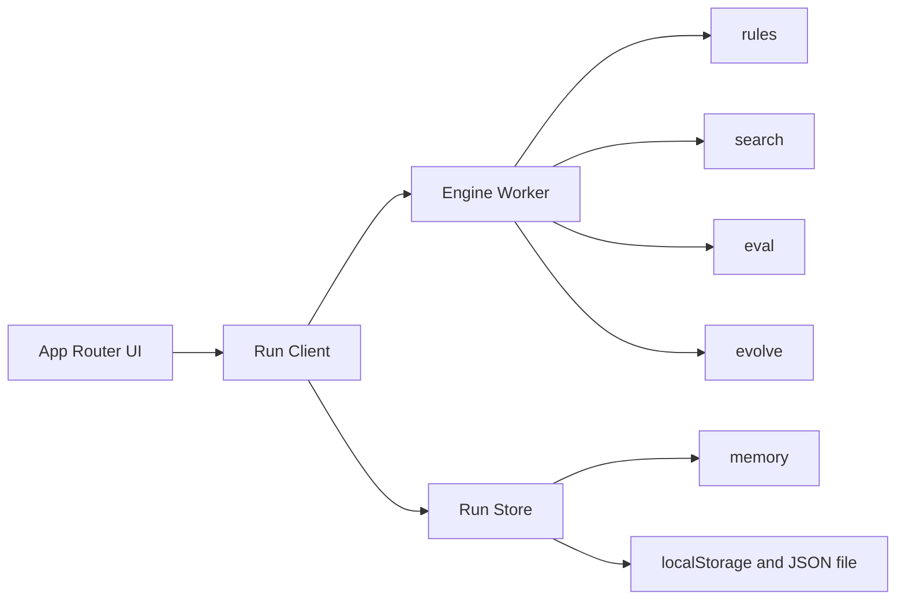

# Architecture

## Shape

A Next.js app running in the browser. The server delivers static files and pages. In phases 1–3 it does not compute games or evolution.



The UI does not call search functions inside the worker. It knows the message types.

## Directory

```text
src/
  app/                  route screens
  components/           board, shell, telemetry, preset cards
  engine/
    rules.ts            legal moves and game end
    eval.ts             score from a genome
    search.ts           negamax, horizon, mcts
    evolve.ts           selection, crossover, mutation
    presets.ts          preset definitions and initial genomes
    types.ts
  worker/
    protocol.ts         message schema
    engine.worker.ts
  store/
    run.ts              current run, generation log, persistence
  styles/
```

`engine/` does not know about the DOM or React. Tests target the pure functions in this folder.

## Module boundaries

| Module | Responsibility | Outside its job |
| --- | --- | --- |
| `rules` | Move generation, apply, termination, FEN, move log | Judging which move is good |
| `eval` | Integer score from a genome and a position, white's point of view | Search, randomness |
| `search` | Choose a move inside a budget. Return nodes visited | Changing a genome |
| `evolve` | One generation's match and the next population | Screen, storage |
| `lineage` | Parent chain for one individual. Follows `parents[0]` | Changing a genome |
| `presets` | Immutable settings over the modules above | Runtime state |
| `store` | Run state and persistence | Chess rules |

Search may call evaluation. Evaluation does not call search.

## Data

Identifiers are strings. Random numbers come only from a counter derived from the run seed.

```ts
type Side = "w" | "b";

type Genome = {
  id: string;
  presetId: string;
  // Piece order: P N B R Q
  material: [number, number, number, number, number];
  // 6 piece types × 64 squares. Square order is a1=0 … h8=63
  pst: number[];
  // Larger values weigh sparse features such as bishop pair and mobility. Phase 1 may keep these at 0
  terms: number[];
};

type Individual = {
  id: string;
  genome: Genome;
  parents: [string, string] | null;
  generation: number;
};

type Preset = {
  id: string;
  name: string;
  summary: string;
  search: "negamax" | "mcts";
  evolvable: boolean;
  defaultBudget: Budget;
  createInitialGenome: (rng: Rng) => Genome;
};

type Budget = {
  maxDepth: number;
  maxNodes: number;
  // mcts only. negamax presets use 0
  simulations: number;
};

type GameRecord = {
  id: string;
  whiteId: string;
  blackId: string;
  moves: string[]; // UCI
  result: "1-0" | "0-1" | "1/2-1/2";
  reason: "checkmate" | "stalemate" | "fifty-move" | "threefold" | "insufficient" | "ply-cap";
  plyCap: boolean;
};

type GenerationRecord = {
  index: number;
  presetId: string;
  seed: number;
  budget: Budget;
  population: Individual[];
  games: GameRecord[];
  scores: {
    id: string;
    fitness: number;
    anchorPoints: number;
    peerPoints: number;
    famePoints: number | null;
  }[];
  bestId: string;
  nodes: number;
  elapsedMs: number;
};

type HallEntry = {
  individual: Individual;
  anchorPoints: number;
};

type Run = {
  schema: 1;
  appVersion: string;
  id: string;
  seed: number;
  presetId: "darwin";
  rngState: number;
  population: Individual[];
  generations: GenerationRecord[];
  hallOfFame: HallEntry[];
  updatedAt: string;
};
```

`GenerationRecord.population` is the population that played. `Run.population` is the population that plays next. `elapsedMs` is wall time and is not part of the seed replay.

If a genome array length disagrees with the preset definition, the run is rejected. Lengths are not silently trimmed.

`hallOfFame` keeps up to 8 entries with the best anchor scores at the end of a generation. Each entry stores the individual and the anchor score used to drop the lowest. The next generation's opponent pool includes at least one of them when the hall is not empty.

## Worker protocol

Requests and responses pair on a one-way job id. In-flight work is cancelled with `cancel`. A late result from a cancelled job is dropped.

```ts
type WorkerRequest =
  | { kind: "search"; jobId: string; fen: string; genome: Genome; budget: Budget; search: "negamax" | "horizon" | "mcts"; seed: number }
  | { kind: "generation"; jobId: string; run: Run; budget: Budget }
  | { kind: "resume"; jobId: string }
  | { kind: "cancel"; jobId: string };

type WorkerEvent =
  | { kind: "search-done"; jobId: string; move: string; nodes: number; score: number; pv: string[]; tieBreak: boolean }
  | { kind: "generation-progress"; jobId: string; gamesDone: number; gamesTotal: number }
  | { kind: "generation-paused"; jobId: string; gamesDone: number; gamesTotal: number }
  | { kind: "generation-done"; jobId: string; generation: GenerationRecord; rngState: number; population: Individual[]; hallOfFame: HallEntry[] }
  | { kind: "error"; jobId: string; message: string };
```

A generation job plays one game at a time and yields between games, so cancel and resume are visible. `generation-done` returns the record of the games just played, the next `population`, the updated `hallOfFame`, and the next `rngState`. The UI does not assemble intermediate genomes.

Pause is in-session. The worker keeps the job until resume, a new generation replaces a paused job, or the page is reloaded. A reload keeps only completed generations in `localStorage`.

Progress events omit board state. Watch replays completed `games[].moves`.

## Storage

- Runtime state is one in-memory `Run`.
- At the end of each generation, serialize a Darwin run to `localStorage` key `chessy.run.v1`, a Synapse run to `chessy.synapse.v1`, and a Pilot run to `chessy.pilot.v1`.
- A Synapse generation keeps the 24,673 weights on the current population, the hall of fame, and the newest generation. Older generation records keep the games, scores, and genome id, with an empty weight list. That keeps one run from growing by about 5 MB per generation.
- Export writes that same JSON to a file. Import checks `schema: 1` with preset `darwin`, or `schema: 2` with preset `synapse`, and rejects a file whose preset does not match the open screen.
- Preset definitions are not stored. A save stores `presetId` and resolves it through the app's preset table.

A human Play session is not part of `Run`. The selected preset is `chessy.preset.v1`. Play best stores that genome at `chessy.opponent.v1`. Darwin and Synapse search it with negamax. Pilot searches it with the policy rollout. Darwin keeps a weight opponent. Synapse keeps a network opponent. Pilot keeps a pilot opponent. Classic, Positional, Horizon, and Surveyor clear the override. The other run slot stays. An in-progress generation asks before it is stopped. A refresh may reset the game in progress. The evolution log is what persists.

## Randomness

Use one small integer generator, such as `mulberry32`. Saving the seed and `rngState` reproduces the next draw.

Randomness is used for:

- The small initial noise on a Darwin genome
- Hall-of-fame opponent selection
- Tie-breaks among equal root moves
- Mutation

Ring pairing inside the population does not use randomness. The consumption order inside one generation follows [algorithms.md](algorithms.md).

Alpha-beta cutoffs do not depend on randomness.

## Tests

Vitest. Run `engine/` without a browser.

| Target | Check |
| --- | --- |
| rules | Starting perft(1)=20, perft(2)=400, perft(3)=8902. Castling, en passant, and promotion fixtures |
| eval | The same genome and FEN yield the same score. On positions that differ only by material, the Classic sign matches the material advantage |
| search | At depth 1, it plays a free capture. It plays mate in 1. Horizon refuses a capture that hangs the queen. Surveyor, from a fixed seed, takes a free queen |
| evolve | Generation 1 at a fixed seed matches a snapshot. The two elites' genome bytes match their parents |
| presets | Darwin and Positional `pst` length is 384 |

UI tests are outside phase 1. Applying a move on Play is covered by engine tests.

## Performance budget

Default Darwin generation, one worker on a laptop:

- Population 12
- Game count from the ring schedule in [algorithms.md](algorithms.md). 72 games when the hall of fame exists, 48 on the first generation
- At most 80 plies per game. Past the cap the game is a draw with `reason: "ply-cap"` and `plyCap: true`. This cap is separate from the fifty-move rule
- Depth 2, node cap 2_000
- Target: one generation within 30 seconds. Past that, the user lowers the node cap through the on-screen budget. The code does not quietly shrink search

Telemetry builds `nodes/s` from the worker's `nodes` count and elapsed time.

## Extension points

- `search` is `negamax`, `horizon`, `mcts`, or `pilot`. Horizon and Surveyor are selected by that field. Darwin's best individual stays on `negamax`. Pilot uses UCT and a genome-backed rollout.
- Synapse is schema 2. `NetworkGenome` has `kind: "network"` and a flat `weights` array. The shared weight `Genome` has no `kind` and no neural field. Both run in the same worker. The sparse forward pass is the performance strategy. There is no Python service.
- If server compute is required later, an adapter accepts the same `WorkerRequest` over HTTP. The UI client swaps that adapter only.
