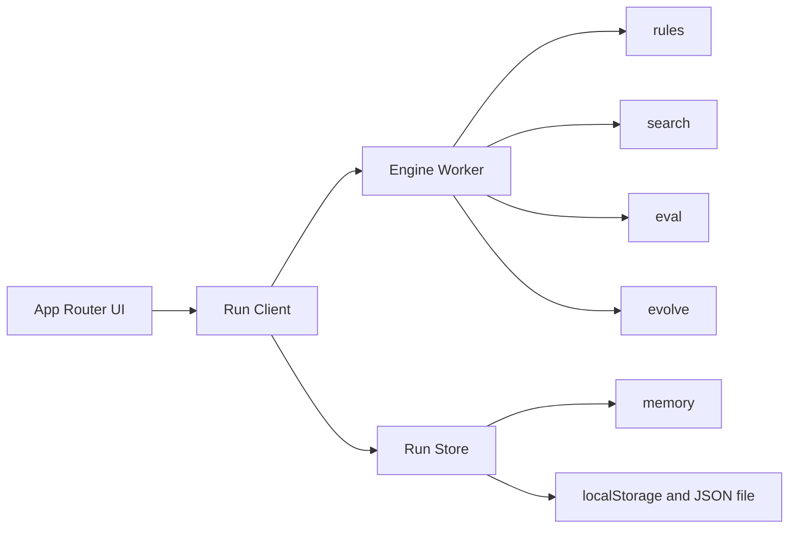

# Architecture

## Shape

A Next.js app running in the browser. The server delivers static files and pages. In phases 1–3 it does not compute games or evolution.



The UI does not call search functions inside the worker. It knows the message types.

## Directory

```text
src/
  app/                  route screens
  components/           board, shell, telemetry, preset cards
  engine/
    rules.ts            legal moves and game end
    eval.ts             score from a genome
    search.ts           negamax, later mcts
    evolve.ts           selection, crossover, mutation
    presets.ts          preset definitions and initial genomes
    types.ts
  worker/
    protocol.ts         message schema
    engine.worker.ts
  store/
    run.ts              current run, generation log, persistence
  styles/
```

`engine/` does not know about the DOM or React. Tests target the pure functions in this folder.

## Module boundaries

| Module | Responsibility | Outside its job |
| --- | --- | --- |
| `rules` | Move generation, apply, termination, FEN, move log | Judging which move is good |
| `eval` | Integer score from a genome and a position, white's point of view | Search, randomness |
| `search` | Choose a move inside a budget. Return nodes visited | Changing a genome |
| `evolve` | One generation's match and the next population | Screen, storage |
| `presets` | Immutable settings over the modules above | Runtime state |
| `store` | Run state and persistence | Chess rules |

Search may call evaluation. Evaluation does not call search.

## Data

Identifiers are strings. Random numbers come only from a counter derived from the run seed.

```ts
type Side = "w" | "b";

type Genome = {
  id: string;
  presetId: string;
  // Piece order: P N B R Q
  material: [number, number, number, number, number];
  // 6 piece types × 64 squares. Square order is a1=0 … h8=63
  pst: number[];
  // Larger values weigh sparse features such as bishop pair and mobility. Phase 1 may keep these at 0
  terms: number[];
};

type Individual = {
  id: string;
  genome: Genome;
  parents: [string, string] | null;
  generation: number;
};

type Preset = {
  id: string;
  name: string;
  summary: string;
  search: "negamax" | "mcts";
  evolvable: boolean;
  defaultBudget: Budget;
  createInitialGenome: (rng: Rng) => Genome;
};

type Budget = {
  maxDepth: number;
  maxNodes: number;
  // mcts only. negamax presets use 0
  simulations: number;
};

type GameRecord = {
  id: string;
  whiteId: string;
  blackId: string;
  moves: string[]; // UCI
  result: "1-0" | "0-1" | "1/2-1/2";
  reason: "checkmate" | "stalemate" | "fifty-move" | "threefold" | "insufficient" | "ply-cap";
  plyCap: boolean;
};

type GenerationRecord = {
  index: number;
  presetId: string;
  seed: number;
  budget: Budget;
  population: Individual[];
  games: GameRecord[];
  scores: {
    id: string;
    fitness: number;
    anchorPoints: number;
    peerPoints: number;
    famePoints: number | null;
  }[];
  bestId: string;
};

type Run = {
  schema: 1;
  appVersion: string;
  id: string;
  seed: number;
  presetId: string;
  rngState: number;
  generations: GenerationRecord[];
  hallOfFame: Individual[];
  updatedAt: string;
};
```

If a genome array length disagrees with the preset definition, the run is rejected. Lengths are not silently trimmed.

`hallOfFame` keeps up to 8 individuals with the best anchor scores at the end of a generation. The next generation's opponent pool includes at least one of them.

## Worker protocol

Requests and responses pair on a one-way job id. In-flight work is cancelled with `cancel`. A late result from a cancelled job is dropped.

```ts
type WorkerRequest =
  | { kind: "search"; jobId: string; fen: string; genome: Genome; budget: Budget; search: "negamax" | "mcts" }
  | { kind: "generation"; jobId: string; run: Run; budget: Budget }
  | { kind: "cancel"; jobId: string };

type WorkerEvent =
  | { kind: "search-done"; jobId: string; move: string; nodes: number; score: number; pv: string[] }
  | { kind: "generation-progress"; jobId: string; gamesDone: number; gamesTotal: number }
  | { kind: "generation-done"; jobId: string; generation: GenerationRecord; rngState: number }
  | { kind: "error"; jobId: string; message: string };
```

A generation job updates the population only inside the worker and returns one `GenerationRecord`. The UI does not assemble intermediate genomes.

Progress events omit board state. Watch replays completed `games[].moves`. Live relay comes in phase 2, after generations are stable, by streaming the same game record as moves append.

## Storage

- Runtime state is one in-memory `Run`.
- At the end of each generation, serialize it to `localStorage` key `chessy.run.v1`.
- Export writes that same JSON to a file. Import checks `schema: 1`.
- Preset definitions are not stored. A save stores `presetId` and resolves it through the app's preset table.

A human Play session is not part of `Run`. It is a separate `PlaySession`, outside phase-1 persistence. A refresh may reset the game in progress. The evolution log is what persists.

## Randomness

Use one small integer generator, such as `mulberry32`. Saving the seed and `rngState` reproduces the next draw.

Randomness is used for:

- The small initial noise on a Darwin genome
- Hall-of-fame opponent selection
- Tie-breaks among equal root moves
- Mutation

Ring pairing inside the population does not use randomness. The consumption order inside one generation follows [algorithms.md](algorithms.md).

Alpha-beta cutoffs do not depend on randomness.

## Tests

Vitest. Run `engine/` without a browser.

| Target | Check |
| --- | --- |
| rules | Starting perft(1)=20, perft(2)=400, perft(3)=8902. Castling, en passant, and promotion fixtures |
| eval | The same genome and FEN yield the same score. On positions that differ only by material, the Classic sign matches the material advantage |
| search | At depth 1, it plays a free capture. It plays mate in 1 |
| evolve | Generation 1 at a fixed seed matches a snapshot. The two elites' genome bytes match their parents |
| presets | Darwin and Positional `pst` length is 384 |

UI tests are outside phase 1. Applying a move on Play is covered by engine tests.

## Performance budget

Default Darwin generation, one worker on a laptop:

- Population 12
- Game count from the ring schedule in [algorithms.md](algorithms.md). 72 games when the hall of fame exists, 48 on the first generation
- At most 80 plies per game. Past the cap the game is a draw with `reason: "ply-cap"` and `plyCap: true`. This cap is separate from the fifty-move rule
- Depth 2, node cap 2_000
- Target: one generation within 30 seconds. Past that, the user lowers the node cap through the on-screen budget. The code does not quietly shrink search

Telemetry builds `nodes/s` from the worker's `nodes` count and elapsed time.

## Extension points

- The `search: "mcts"` branch lands in `search.ts` in phase 3. The protocol's `search` field is filled then.
- A Synapse genome bumps the schema to 2 with a `kind` on `Genome`. Phase-1 JSON does not carry an empty neural field ahead of time.
- If server compute is required, an adapter accepts the same `WorkerRequest` over HTTP. The UI client swaps that adapter only.
